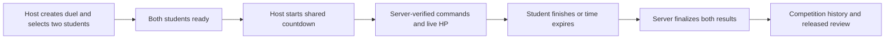

# CLI Duel pilot — design for owner approval

Date: November 16, 2026. Status: **Owner approved November 16, 2026; implementation plan preparation in progress.**

The owner approved proceeding with the first recommended competition pilot and separate competition results/history. The owner subsequently approved this written design, including the single-device pilot boundaries and defaults, and explicitly confirmed a time limit to add pressure. No commit, push, hosted function deployment, database migration, or environment change is authorized by this design.

## Intent and confirmed requirements

Students compete by correctly configuring simulated Cisco equipment. Administrators may select eligible students across classes; instructors may select only students in classes they handle. Highest verified final score wins; shortest completion time breaks an equal-score tie. Exact score/time ties share placement. HP is an engaging view of verified configuration progress. Competition history remains separate from ordinary CLI results and academic grades, and competition participation does not consume normal practical attempts.

Each match retains its original task, grading rules, roster, results and evidence. Students can inspect their own work after the host releases review. They cannot inspect an opponent's commands, secrets, expected configuration, or device state.

## Approaches and recommended size

1. **Trusted server execution of the existing simulator — recommended.** A server replays commands against server-held state and existing SQL criteria grade the result. This preserves familiar CLI behavior and supports verifiable score/HP/history, but needs an authenticated Edge Function, database changes and tests.
2. **A separate SQL command interpreter.** This avoids moving simulator execution but duplicates the existing command semantics and would require maintaining two interpreters. It is not recommended for this pilot.
3. **Browser-computed score/HP.** Suitable only for a noncompetitive visual prototype. Current normal CLI calls send browser-produced state, so this would not establish trusted rankings. It is not the proposed ranked implementation.

This is a new feature project. First delivery is a small 1-vs-1 pilot; class-wide racing and tournaments are later extensions.

## Approved first-pilot boundaries

- Exactly two distinct, active student accounts per match; administrator and instructor hosting as confirmed above.
- One Cisco switch or router, with no physical links, PC configuration, remote SSH or multi-device connectivity objectives in the first pilot. The selector must explain why an existing practical is incompatible rather than silently omit criteria.
- Supported criteria: hostname, enable_secret, password_encryption, banner_motd, line_password, line_login, interface_description, interface_enabled, interface_ip, config_saved; switch-only vlan_exists, vlan_name, interface_mode, interface_access_vlan. Every criterion must be applicable to the selected device and have a positive finite point value. Empty/incomplete/unsupported rubrics cannot start a match.
- Starting configuration is generic and not preconfigured with the required answers. Preflight grading must show zero earned points in the initial state; reject a challenge with already-completed or conflicting duplicate objectives and explain what the host must correct. Use the current simulator's supported syntax; aliases count according to the same engine.
- One shared challenge and point scale per match. No randomized value sets, bonus scoring, random critical hits, gradebook integration, persistent XP, teams, spectator links, chat or public matchmaking.
- Online play; no offline queue of ranked commands. Preserve the last verified server state during a disconnect and allow resume. The common clock continues.
- No permanent deletion or manual score editing in the pilot. Hosts can cancel unfinished matches with a recorded reason. Completed matches can be voided with an audit reason; original results remain visible as voided and do not count toward win/loss statistics.

## Match and history flow

Host flow: Competitions → Create duel → choose a compatible practical, title, duration, two participants and review setting → lobby → Start when both ready → monitor → results. Competition creation freezes a copy of the practical. Editing the source later cannot change that match; a new/rematch draft can explicitly select an updated source.

Student flow: Competitions → invitation/lobby → Ready → common countdown → focused CLI with own score, opponent HP/progress, timer and connection status → own submission/result → competition history. A browser refresh resumes the same match; it never creates a new attempt. Both students may complete the same objective independently.

Readiness must identify the actual student's browser, not a host-supplied client ID. Host Start checks both students' current eligibility/readiness and shared assessment-session availability atomically. Countdown: 10 seconds; the host sets Time limit (minutes), prefilled from the chosen practical, as a whole number from 1 to 480. Both students share the same starts_at and deadline. Show a visible remaining-time display and a text warning during the final 60 seconds, with no mandatory sound. Duration cannot change after Start. The owner explicitly requested the time limit to add pressure. Roster, challenge, points, review policy and duration are locked once countdown begins. No host pause in the first pilot; cancellation is available.

One working CLI attempt per participant; partial-score Finish requires confirmation and locks that participant's work. Reaching 100% verified configuration automatically finishes that participant. Their opponent may continue until finishing or the common deadline. Final winner labels wait until settlement; live standings are provisional.

## Scoring, HP and time

The existing SQL criterion evaluator, applied to server-verified state and the frozen rubric, awards each objective's configured points while it is correct. Repeating a command or toggling an objective cannot accumulate extra credit. Breaking a correct configuration removes its current credit. Accepted syntax, entering modes and diagnostic commands do not themselves award points unless they satisfy a configured supported criterion.

Opponent HP = 100 minus the participant's current verified score percentage, clamped to 0–100. This also means opponent HP recovers if the participant undoes a correct objective. Animations are cosmetic and cannot interrupt input, stun a player, or alter ranking. Provide reduced-motion behavior and default to no sound.

Rank by exact score points on the common frozen rubric, descending; then elapsed server time, ascending. Do not rank using a rounded display percentage. Shared place for exact ties; no hidden tertiary ID/name sort presented as a winner. Elapsed time runs from the common starts_at to the server's accepted participant submission or automatic 100% completion. A timed-out participant uses the deadline as finish time. The timer never stops for an individual disconnect. Network and server processing latency can affect close finishes; the pilot does not claim keystroke-level fairness.

Only commands committed by the trusted server before the deadline may change scored state. Late commands are rejected; no browser timestamp or local queue may backdate them. Manual Finish, automatic completion and timeout must serialize with pending commands so there is exactly one authoritative final result. Settlement recomputes from the last verified state, freezes participant results including per-criterion met/points-awarded outcomes, and produces placements once. Historical review reads these frozen outcomes rather than recomputing them under a later grading implementation. No HP-derived independent victory rule.

Matches not started remain unranked. A cancelled invitation/lobby records Did not start. Cancelled/voided matches stay in history and are excluded from win/loss statistics. A rematch creates a new record; prior history is immutable.

## Authorization

- Every operation checks the authenticated account, current role and ban status. UI visibility is not an access boundary.
- Admins can host across all eligible students and review all competitions. Instructors can use their own authorized practicals and select participants through classes they own. Record the qualifying class for each instructor-selected participant.
- Instructor hosting, monitoring and review require current ownership of the relevant roster classes; transfers remove that instructor's access. Admins retain oversight. Participant identity/class labels are snapshotted so old history remains understandable.
- Eligibility is rechecked at Start. After Start the roster is fixed; a later unenrollment does not erase the student's own historical result. Banned/inactive accounts cannot submit commands. Any resulting intervention/cancellation is audited, not converted into an automatic cheating penalty.
- Participants can receive only their own command/state responses and a safe opponent/standing summary (competition display name, score, HP, status and published finish time). No broad roster reads and no opponent email, commands, configuration, grading key or expected credentials.
- Safe reads and live subscriptions must obey the same role/roster boundaries. Clients cannot publish trusted score events.

## Server execution and persistence

Proposed dedicated records: cli_competitions (metadata, lifecycle and public/private challenge snapshot), cli_competition_participants (fixed roster, qualifying class, readiness, state revision, state, score and final timing), cli_competition_commands (ordered command ID/text/output and actor), and cli_competition_events (audit/scoring deltas). Store private criteria/expected values where student reads cannot reach them. Do not put competition records in cli_attempts or alter ordinary attempt counts, quiz/CLI history, result summaries or academic exports.

Use a single canonical pure simulator module, shared by the browser and a new competition Edge Function. The implementation may relocate it into supabase/functions/_shared with the existing browser module re-exporting its unchanged public API. Existing simulator tests must prove parity. This is shared code, not shared client state.

Authenticated command request: competition ID, client lease ID, unique command ID, expected revision/sequence and command text. Never accept a browser-supplied score, accepted flag, device state, HP, opponent ID or finish timestamp as authoritative.

The Edge Function verifies the user's real token, derives the actor UID, checks access and obtains private server-held context. It executes the command against that state. A service-only commit RPC atomically verifies actor/roster/lease/status/deadline/revision again, stores the result, computes rubric credit and HP, and records events. Service credentials never enter frontend code or Vite configuration. SQL must deny authenticated/anonymous direct writes and access to service-only context/commit methods.

Serialize participant commands with monotonic sequence/revision checks. A repeated command ID with identical content returns its original result, without new points/events. Reusing that ID with different content is rejected. Stale revisions require resync; concurrent requests cannot overwrite state or silently reorder input. Keep one command in flight per client. Retry an uncertain network response with the same command ID.

Use private per-match database broadcasts containing only competition ID and an increasing event revision as invalidation notices. Fetch scores/HP/names through the authorized safe RPC on receipt; do not put those protected fields into a broadcast. Recheck authorization on each fetch and periodically while a view is open, clearing it on denial. This avoids leaking updated protected content through an already-established channel after a role/class-ownership change. On reconnect or a missed event, fetch the canonical server state; do not rebuild official results by adding received animation events. Provide a quiet HTTP fallback if live subscription fails. Do not broadcast private command/state/criteria payloads.

Finalize due matches on authorized reads/actions and participant deadline requests, using stored deadline timing rather than the later cleanup time. A deployment may add scheduled reconciliation for timely background settlement; correctness must not depend on an open browser. Terminal results and events are immutable apart from explicit audited void status.

## Integration with existing assessment controls

Competitions need the same one-active-assessment and one-browser protection as quizzes and CLI practicals. Extend active_assessment_sessions to an explicit competition type. Audit every type switch in session descriptions, claim/assert/heartbeat/release, expiry handling, start guards and student routing. Reserve both leases atomically in stable UID order at host Start; ordinary quiz/CLI starts must reject an active competition, and competition start must reject an active quiz/CLI or another match. A lobby Ready record is not an assessment lease. Release each participant's lease when their work locks; a finished participant may observe the rest of the match.

Student resume/navigation/Overview must explicitly recognize competition; no existing else branch may interpret it as a CLI attempt. Keep ordinary quiz/CLI storage keys and policies unchanged. Normal assessment grading and review permissions must remain protected by their current guards. Missing competition migration/function must give a contained unavailable/setup message while leaving existing assessment pages usable.

Proposed routes: /instructor/competitions and /admin/competitions for host lists/lobbies/history; /student/competitions for invitations/history; /student/competition/:participantId for the focused player. Verify refresh, Back/Forward, role guards and breadcrumbs.

## Results and review

Dedicated competition history shows match title, mode, host, participants, final score/max points, elapsed time, placement, status and completion date. Live values are labelled provisional until settlement. Standard CLI history, academic pass rates and normal attempt limits exclude all competition records by construction.

Host detail: authorized participant summaries, commands, objective results, scoring timeline and connection/audit events. Student detail: permitted standings plus their own submitted work. Reuse existing CLI review presentation (device-labelled criteria and filtered command log), without Final Device State display.

Proposed release control: Allow detailed review, default off. When enabled, student expected configuration/feedback/command review opens only after the whole match finishes. No early answer-key release when the first student submits. Hosts may release/withdraw review afterward, audited; withdrawal clears open detailed student content on revalidation. Standings and own score/time remain visible. Cancellation/voiding does not automatically release an answer key.

## Local work, checkpoint and validation

Keep all development local and uncommitted; no deployment, hosted migration, secret change or image pull is part of design approval. A checkpoint preserves the already-reviewed UI, existing notes and untracked UI tests before competition work. It is recorded separately in the project log. Checkpoint: `C:\Users\Campos\AppData\Local\Temp\ccna-cli-duel-baseline-20261116-153425` (working-folder.zip and manifest.json), including the current uncommitted, locally reviewed UI work.

Inspection found Docker CLI present, but its daemon was unavailable; Supabase CLI and Deno were not found on PATH. A real local multi-user stack therefore needs setup before authenticated acceptance. Pure Node and isolated PostgreSQL tests plus intercepted browser checks are useful but must not be represented as real end-to-end acceptance. Never connect local competition tests to hosted production data as a shortcut.

Required evidence before calling the pilot complete:

- Server-executed commands match the existing simulator for every supported criterion; wrong-but-valid commands, aliases, repeated commands and undo/redo behave correctly.
- SQL tests cover private keys, forged actor/state/score/time payloads, other-class instructors, outsiders/banned users, two-player atomic starts, duplicate IDs, stale revisions, concurrent submission, timeout boundaries, cancelled/voided matches and immutable history.
- Existing one-active-session, client lease, quiz/CLI grading/history and role routing regressions pass.
- Both real test students can Ready/start, configure independently, reconnect/resume, finish and review only their own permitted details on a local/test Supabase stack.
- Highest score then time, exact ties, HP reversal and timeout results match the written rules. Live display converges after missed messages.
- Desktop/phone, keyboard/focus, reduced motion, empty/error/setup states, lint/build and secret scan pass.
- A rollback manifest includes touched files and pre-migration local database/function backups before any local migration is applied. Existing accepted UI remains recoverable.

## Deferred extensions

Class-wide races, multi-device/PC/connectivity challenges, teams/tournaments, randomized values, persistent achievements/XP, academic grading, granular disqualification/corrections and spectators require separate approval after the pilot. This design does not mark F1 or the broader UI phases complete.

## Time-limit confirmation

Owner steering: "consider also that there is a time limit to add pressure". Time pressure is a core pilot requirement. At the common deadline, finalize each unfinished participant from their last server-verified configuration, reject all late scoring changes, and use the deadline as their elapsed-time endpoint. No speed bonus or additional scoring rule is introduced: final score still ranks first and completion time breaks ties. The screen timer is informational; server time is authoritative.

## Primary references

- https://supabase.com/docs/guides/functions/auth
- https://supabase.com/docs/guides/functions/development-tips
- https://supabase.com/docs/guides/realtime/subscribing-to-database-changes
- https://supabase.com/docs/guides/realtime/authorization

## Design review record

A fresh read-only builder review found no important unanswered planning questions. Trusted execution, scoring, deadlines, session interoperability and history rules are specified. The owner subsequently approved the written design. The implementation plan is being prepared; product code has not been written.
